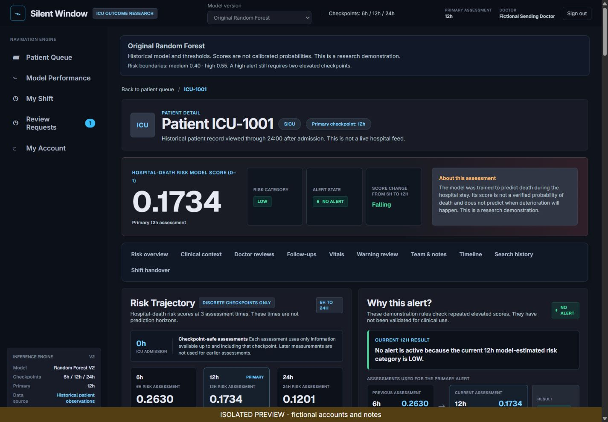
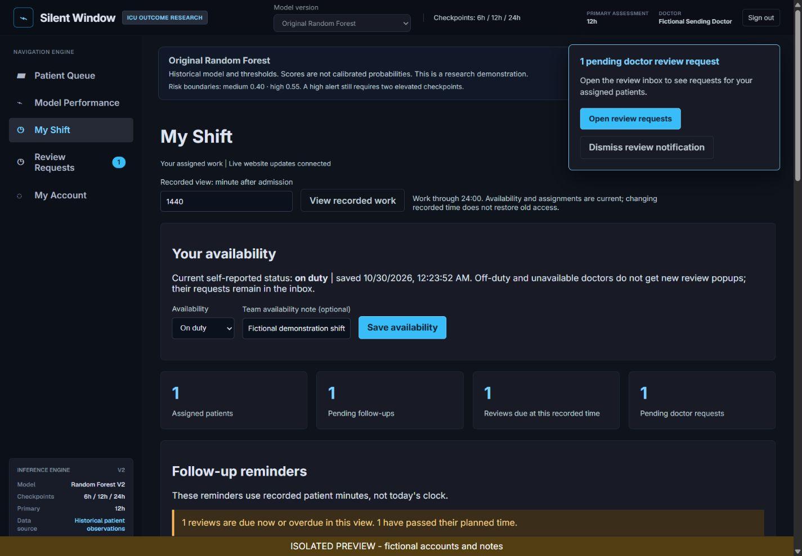
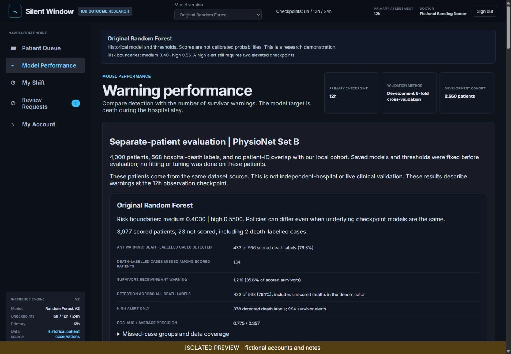

# Silent Window

An ICU research dashboard with patient risk assessments, staff accounts and team workflows.
Built with **React, FastAPI, MySQL and scikit-learn**.

Continuing this project in another chat or on another laptop? Start with the
[complete project handover](docs/PROJECT_HANDOVER.md).

The saved models estimate **death during the hospital stay** from recorded patient
measurements. Scores are research outputs, not verified individual death probabilities.
This is a portfolio demonstration using public historical data, not a live hospital system.

## Features

- Five roles: administrator, doctor, nurse, ICU coordinator and researcher.
- Worker signup requests with administrator approval or rejection.
- Separate doctor and nurse assignments, with multiple staff members per patient.
- Patient queues, checkpoint assessments, review notes and acknowledgements.
- Original Random Forest, calibrated candidate and five-checkpoint candidate.
- Assessments at 6 / 12 / 24 hours; the expanded candidate also supports 9 / 18 hours.
- Historical replay with play, pause, speed and reset controls.
- Account preferences, password visibility, password change and assisted recovery.
- Backend permission checks, hashed passwords and restricted MySQL access.
- Separate invasive/cuff BP histories, staff-entered admission context and responsible doctor.
- Structured demonstration visit notes, follow-up plans and a patient timeline.
- Doctor-entered vital warning limits kept separate from mortality-model alerts.
- My Shift dashboard, recorded-time follow-up reminders and staff availability.
- Confirmed doctor/nurse shift handovers with captured tasks and assignment transfer.
- Searchable staff history, permission-checked PDF summaries and live website updates.
- Fixed-policy evaluation on 4,000 additional public patients, with missed cases and survivor warnings shown separately.

The interface currently focuses on laptop screens.

## Screenshots

These screens use fictional staff accounts and notes in an isolated preview.
The public patient observations remain recorded research data.







For a short demonstration and resume wording, see the
[demo and resume guide](docs/demo-and-resume.md).

## Quick start on Windows

Install **Python 3.11**, **Node.js 22 or newer** and **MySQL 8** first. Start your
MySQL server on port 3306. Download and extract the project, then open PowerShell
inside the folder containing this README.

```powershell
powershell -ExecutionPolicy Bypass -File .\setup_silent_window.ps1
.\run_silent_window.bat
```

Setup installs the pinned packages, checks the bundled data and models, and
prompts for **your own MySQL administrator password** to create the project schemas
and restricted database accounts. It saves restricted credentials locally in an
ignored `.env` file. Your MySQL administrator password is not saved.

Open **http://127.0.0.1:5173/** and create your first website administrator account.
There is **no default username or password**. Workers can then request accounts.

The download includes the required frozen research cohort and all saved models.
Starting the website does not train models. Package installation needs internet
access. The Windows installer refuses to overwrite an initialized database.

For manual setup, macOS/Linux commands, existing databases and troubleshooting,
see the [setup guide](docs/setup-guide.md).

## Check the project

```powershell
.venv\Scripts\python.exe -m pip install -r requirements-dev.txt -c requirements-lock.txt
.venv\Scripts\python.exe -m pytest tests -q
cd frontend
npm test
npm run build
```

Optional MySQL integration tests use only a separate `_auth_test` schema. The
application itself requires MySQL; SQLite is used only by isolated tests.
The included GitHub Actions workflow runs the source checks, backend tests,
frontend tests and build on Windows after publication. It needs no private keys
or connection to the developer's database; MySQL integration tests are skipped
when no isolated test server is configured.

## Project structure

- `frontend/` — React interface and frontend checks.
- `backend/` — FastAPI endpoints, permissions and account workflows.
- `ml/` — preprocessing, model experiments and saved model bundles.
- `data/raw/` — the frozen public research cohort and attribution.
- `data/processed/` — aggregate evaluation results and frozen cohort metadata.
- `scripts/` — setup, verification, reproducible research and release tools.
- `tests/` — backend, model and storage checks.
- `docs/` — setup, feature instructions and research explanations.

## Data and model limits

The bundled 3,200-record subset comes from the
[PhysioNet/Computing in Cardiology Challenge 2012](https://physionet.org/content/challenge-2012/1.0.0/),
made available under the
[Open Data Commons Attribution License v1.0](https://physionet.org/content/challenge-2012/view-license/1.0.0/).
See [dataset attribution and provenance](data/raw/DATASET.md).

Checkpoints mean hours **after ICU admission**, not predictions for the next
6, 12 or 24 hours. Recorded replay is not live streaming. Alert thresholds are
research rules. Higher detection can also produce more survivor warnings.
The research candidates did not meet every promotion criterion; independent-hospital and prospective
validation remain necessary. Do not use the saved scores for patient care.

See [prediction task](docs/prediction-task.md),
[data quality and evaluation](docs/data-quality-and-evaluation.md),
[model comparison](docs/model-improvement-comparison.md) and
[checkpoint expansion](docs/checkpoint-expansion.md).

See [clinical context enhancements](docs/clinical-enhancements.md) for the new patient
sections and role permissions. See [shift workflows and exports](docs/workflow-upgrades.md)
for schema-7 migration and [separate-patient evaluation](docs/separate-patient-evaluation.md)
for the new model results.

## Accounts and sharing

Each installation creates its own accounts. Passwords, API keys, `.env`, account
databases, staff notes, sessions, runtime caches, dependencies and Git history
are excluded from the clean source archive. No paid API key is required to run
the website. See [accounts and recovery](docs/accounts-and-roles.md).

To check the public source files and reachable Git history:

```powershell
python -m scripts.prepare_release --history
```

To make a checked download without local credentials or account data:

```powershell
python -m scripts.prepare_release --zip dist/silent-window-source.zip
```

The archive contains a file-integrity manifest. It does not publish anything.
See [release instructions](docs/releasing.md) before uploading to GitHub.

The public research database retains its existing ODC attribution license;
see [dataset attribution](data/raw/DATASET.md). Third-party dependencies retain
their own licenses. No application software license is included.
